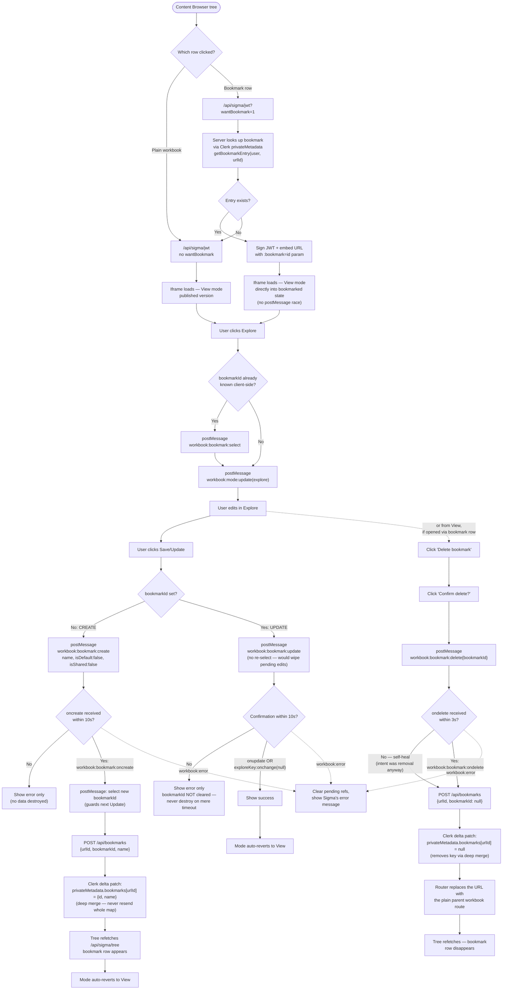

# Embed Success — Sigma Embed Example Site

A production-ready example of embedding [Sigma Computing](https://sigmacomputing.com) analytics into a modern SaaS application. Built with Next.js, Tailwind CSS, Clerk auth, and JWT-based secure embedding.

**Live site:** https://embedexamplesite.vercel.app

---

## What this is

This site demonstrates how to embed Sigma workbooks inside a custom web application using Sigma's JWT embedding API. Logged-in users land on a **use-case gallery** (`/dashboard`) — each card is a real, bookmarkable route demonstrating one embedding capability, not a client-state toggle in a single component. It includes:

- Clerk-authenticated login (email/password, social, or SSO)
- Server-side JWT generation — the embed URL is signed fresh on every request
- **Legacy Examples** — an authenticated internal-user embed and a URL-parameter-filtered variant, plus the **Content Browser** (a live sidebar tree, read via the Sigma REST API, scoped to exactly what the logged-in embed user can access) and **Bookmarks** (embed users can Explore a workbook, save their own view, and return to it later, driven by the Embed SDK's inbound/outbound events)
- **Team Swapping via JWT** — swap which Sigma team an embed user is presented as belonging to via the JWT's `teams` claim, and watch content access follow
- **Sub-Address Swapping via JWT** — a sibling to Team Swapping: instead of a picker, team context follows *which login* the embed user is signed in as (via email sub-addressing), with no `teams` claim sent at all — Sigma resolves access from that member's own real, persistent team assignment. See [Recipe: create-and-embed-immediately](#recipe-creating-a-workbook-via-workbook-as-code-then-embedding-it-immediately) below for the workbook-as-code creation flow both swap pages share.
- A public, no-sign-on anonymous embed page (`/interested`)

This is not a template or a starter kit — it's a working demonstration of a real embed architecture, including the rough edges (timing races, event quirks) you actually hit integrating with Sigma's embed SDK and their real-world behavior.

---

## Architecture

```
Browser
  │
  ├── /dashboard/layout.js
  │     └── Clerk middleware verifies session → DashboardChrome
  │           (global chrome: top nav + JWT inspector — no sidebar; each
  │            use case brings its own via its own layout.js)
  │
  ├── GET /dashboard
  │     └── Use-case gallery — pick what to demo (lib/use-cases.js)
  │
  ├── GET /dashboard/legacy/[slug]  ·  /dashboard/legacy/browse/[urlId]
  │     └── Legacy Examples — real bookmarkable routes, with this use case's
  │           own sidebar (example switcher + Content Browser) from
  │           app/dashboard/legacy/layout.js. Points at a DIFFERENT Sigma org
  │           than everything else (org: 'legacy' on generateSigmaEmbedUrl) —
  │           see "Pointing one use case at a different Sigma org" below.
  │
  ├── GET /dashboard/team-swap?team=<slug>&urlId=<urlId>
  │     └── Team Swapping via JWT — picks a team from a fixed menu; the JWT's
  │           `teams` claim is overridden while `sub` stays the real signed-in
  │           user. Own sidebar: lib/teams.js team list + live file listing.
  │
  ├── GET /dashboard/subaddress-swap?identity=<slug>&urlId=<urlId>
  │     └── Sub-Address Swapping via JWT — picks a sub-addressed LOGIN
  │           (lib/subaddress-identities.js, derived from whoever's signed
  │           in — no hardcoded test account); the JWT's `sub` changes, NO
  │           `teams` claim is sent at all, and Sigma applies that member's
  │           real, persistent team assignment on its own. A preflight
  │           (checkSubAddressSetup) verifies each candidate is a real,
  │           team-assigned member before the sidebar offers it.
  │
  ├── GET /api/sigma/jwt?mode=<mode> | ?urlId=<urlId>&wantBookmark=1
  │     │                            | ?teamSlug=<slug> | ?subAddressSlug=<slug>
  │     └── Server verifies Clerk session → signs JWT with SIGMA_SECRET
  │           └── Returns signed embed URL (+ :bookmark param if requested)
  │                 → iframe renders Sigma content
  │
  ├── POST /api/sigma/team-workbook  { team | identity, name }
  │     └── Creates a workbook via workbook-as-code (POST /v2/workbooks),
  │           owned by the real signed-in user (team path) or the
  │           sub-addressed identity itself (identity path) — see the recipe
  │           below
  │
  └── GET /api/sigma/tree
        └── Server reads the EMBED workspace via the Sigma REST API,
              scoped to the logged-in user's Sigma member grants
              → Content Browser sidebar tree
```

**Why server-side JWT signing matters:** The Sigma embed secret never leaves the server. The browser only ever receives a signed, expiring URL — it cannot forge or extend its own access.

---

## Tech stack

| Layer | Technology |
|---|---|
| Framework | Next.js (App Router) |
| Auth | Clerk (`@clerk/nextjs`) |
| Styling | Tailwind CSS, custom `brand`/`mint`/`ink`/`chart` tokens · DM Sans / DM Mono / Space Grotesk |
| JWT signing | `jose` (HMAC-SHA256) |
| Bookmark storage | Clerk `privateMetadata` (per user, no separate database) |
| Hosting | Vercel (auto-deploys on push to `master`) |

---

## Environment variables

Set these in Vercel (Settings → Environment Variables) or in `.env.local` for local development. See `.env.example` for the full annotated list. Key groups:

```env
# Sigma embed credentials — Sigma Admin → Developer Access → Embedding
SIGMA_CLIENT_ID=
SIGMA_SECRET=

# Default embed URL — the Sigma workbook/page to embed (without ?:embed=true)
SIGMA_BASE_URL=

# Content Browser (REST API) — reads the EMBED workspace tree.
# The REST API host for your org's cloud/region — NOT the embed workbook URL.
#   EU AWS:  https://api.eu.aws.sigmacomputing.com
#   US AWS:  https://aws-api.sigmacomputing.com
#   GCP:     https://api.sigmacomputing.com
SIGMA_API_BASE_URL=
# Optional: dedicated REST API OAuth client (falls back to SIGMA_CLIENT_ID/SECRET
# above if the same Developer Access client is API-enabled).
# SIGMA_API_CLIENT_ID=
# SIGMA_API_SECRET=
# Optional: workspace name to browse (default "EMBED")
# EMBED_WORKSPACE_NAME=EMBED

# Clerk — https://dashboard.clerk.com
CLERK_SECRET_KEY=
NEXT_PUBLIC_CLERK_PUBLISHABLE_KEY=

# Add one per new use-case page (see "Adding a new use-case page" below).
# Example: { mode: 'sales' } → SALES_SIGMA_BASE_URL
# SALES_SIGMA_BASE_URL=

# Legacy Examples only — points that ONE use case at a different Sigma org
# (see "Pointing one use case at a different Sigma org" above). Skip these
# entirely if you don't need a second org.
# LEGACY_SIGMA_CLIENT_ID=
# LEGACY_SIGMA_SECRET=
# LEGACY_SIGMA_BASE_URL=
# LEGACY_SIGMA_API_BASE_URL=
# LEGACY_EMBED_WORKSPACE_NAME=EMBED

# Anonymous embed (/interested page) — every visitor maps to one static Sigma user
INTERESTED_SIGMA_BASE_URL=
ANONYMOUS_SIGMA_SUB=anonymous@embedsuccess.com
ANONYMOUS_SIGMA_ACCOUNT_TYPE=anon

# Optional: embed session length in seconds (default 3600, max 2592000)
# SESSION_LENGTH=3600

# Optional Sigma UI controls (uncomment to enable)
# hide_menu=true
# hide_folder_navigation=true
# disable_mobile_view=true
# responsive_height=true
# theme=
# lng=
```

---

## Content Browser & Bookmarks

The **Content Browser** sidebar (below the two static nav examples) is a live folder/workbook tree, fetched from the Sigma REST API and scoped to exactly what the logged-in embed user can access — including access granted via team membership, since `GET /v2/members/{memberId}/files` resolves effective grants server-side. Clicking a workbook opens it via an ad hoc, `urlId`-based signed embed (`lib/sigma-embed.js`), independent of the `{MODE}_SIGMA_BASE_URL` env-var system used by the static nav examples.

**Bookmarks** let an embed user save their own Explore-mode customization of a workbook and return to it later:

- One bookmark per (Clerk user, workbook), stored in Clerk `privateMetadata` — no separate database.
- Opening a bookmark loads it directly via Sigma's `:bookmark` embed URL parameter (baked into the signed URL server-side), rather than a `postMessage` call after load — this avoids a render race where the iframe's own initial paint could beat a delayed `select`.
- **Save** creates a bookmark the first time (`workbook:bookmark:create`), then **Update**s it thereafter (`workbook:bookmark:update`) — visible only in Explore mode, and automatically reverts to View once saved.
- **Delete** is only shown when a workbook was opened via its bookmark row specifically (not the plain workbook), and removes both the Sigma-side bookmark and the Clerk mapping.

**Real-world quirks this integration works around**, worth knowing if you build on this:
- Clerk's `updateUserMetadata` performs a **deep merge** — the only way to remove a nested key is to set it to `null` in a delta patch, not recompute and resend the whole object (an empty `{}` is a no-op for removal).
- This embed doesn't reliably fire the documented `workbook:bookmark:onupdate` outbound event — in practice, `workbook:exploreKey:onchange` (with `exploreKey: null`) is the event that actually confirms a successful update.
- Re-sending `workbook:bookmark:select` immediately before `update` can reload the bookmark to its last-saved state, discarding the very edits you're trying to save — don't re-select right before update if it's already selected.

### Bookmark flow



---

## Team Swapping via JWT · Sub-Address Swapping via JWT

Two use cases that both demonstrate how Sigma resolves an embed user's content access from **team membership**, via two different mechanisms:

| | Team Swapping (`/dashboard/team-swap`) | Sub-Address Swapping (`/dashboard/subaddress-swap`) |
|---|---|---|
| What's picked | A team, from a fixed menu | A **login** — one of four sub-addressed variants (`+tag` email addressing) of whoever's actually signed in |
| JWT `sub` | Stays fixed — the real signed-in user | **Changes** — becomes that sub-addressed email |
| JWT `teams` | **Overridden directly** with the picked team name | **Not sent at all** — Sigma resolves the member's own real, persistent team assignment |
| Demonstrates | Multi-tenant embedding without maintaining per-tenant accounts | A customer's SSO issuing one address per business unit, with team resolution following the login rather than an in-app selector |

Sub-Address Swapping's four candidates (`lib/subaddress-identities.js`) are built from the current user's own email — there's no hardcoded test account. That means they're only usable if *that* account's sub-addressed variants happen to be real, Sigma members already assigned to a team. A **preflight check** (`checkSubAddressSetup` in `lib/sigma-api.js`, run once per visit in `app/dashboard/subaddress-swap/layout.js`) verifies each of the four live before the sidebar offers it — a login that isn't set up renders disabled with the reason shown inline, and the same check surfaces as a small warning on the gallery card itself, visible before you even click in.

---

## Pointing one use case at a different Sigma org

`generateSigmaEmbedUrl` (`lib/sigma-embed.js`) and the REST helpers in `lib/sigma-api.js` take an optional `org` param, orthogonal to `mode`: `mode` picks a workbook *within* the org this app's default credentials point at; `org: 'legacy'` points at a **different org entirely**, via its own `LEGACY_SIGMA_*` env vars (see below). A client_id/secret pair — and any REST API token minted from it — is only valid for the org that issued it, so there's no fallback from `legacy` credentials to the default ones anywhere in this chain. Legacy Examples (both pages, plus its Content Browser and anything opened from it) is the only place that passes `org: 'legacy'` in this app; every other use case uses the default org.

If you don't need this — most integrations only ever talk to one org — skip the `LEGACY_*` env vars entirely and never pass `org`.

---

## Recipe: creating a workbook via workbook-as-code, then embedding it immediately

*Written as a portable technique, not tied to this repo — the file references are pointers to a working implementation, not the only way to do this.*

**The problem:** you want a host application to provision a brand-new, empty Sigma workbook on demand — owned by whichever embed user is asking, in the right folder for them — and have the embed immediately show that new workbook, not the one that was open a moment ago.

**The pieces:**

1. **Resolve identity and destination server-side, never from client input.** The client sends an opaque reference (a slug, a team id) — never a raw email or folder id. The server resolves that reference against its own trusted config/data before doing anything with it. (In this repo: `getSwapTeam`/`getSubAddressIdentity` in `lib/teams.js`/`lib/subaddress-identities.js`, resolved inside `app/api/sigma/team-workbook/route.js`.)

2. **Resolve the owning member and destination folder via the REST API**, not by guessing IDs:
   - `GET /v2/members?email=<address>` → `memberId` (the member who will own the new workbook — this is what makes it "owned by the current user": pass their real `memberId`, not the calling service account's).
   - `GET /v2/workspaces` → match by name → `workspaceUrlId` (the create endpoint's `folderId` is this field, **not** the workspace's `workspaceId` UUID — the two look interchangeable and aren't).

3. **POST a minimal workbook-as-code spec to `/v2/workbooks`.** A workbook needs at minimum one element and a layout referencing it — an empty `elements: []` with no `layout` is accepted by the API but silently produces nothing useful. A single markdown text element works as a placeholder "blank" workbook:
   ```json
   {
     "name": "<workbook name>",
     "folderId": "<workspaceUrlId>",
     "ownerId": "<memberId>",
     "contents": {
       "schemaVersion": 1,
       "kind": "workbook",
       "elements": [{ "id": "title", "kind": "text", "body": "# **<workbook name>**" }],
       "pages": [{ "id": "page1", "name": "Page 1" }],
       "layout": "<?xml version=\"1.0\" encoding=\"utf-8\"?><Page type=\"grid\" gridTemplateColumns=\"repeat(24, 1fr)\" gridTemplateRows=\"auto\" id=\"page1\"><Element elementId=\"title\" gridColumn=\"1 / 25\" gridRow=\"1 / 5\"/></Page>"
     }
   }
   ```
   **Gotchas learned the hard way** (worth verifying still hold before relying on them — Sigma's API evolves):
   - There is no image-upload endpoint, and an *existing* uploaded-image `key` copied from another workbook is not reusable here — a spec with an `image` element referencing one 400s with a masked "1 schema error in data model spec." A text-only spec with no logo is the reliable baseline.
   - `contents.layout` is required in practice even though the OpenAPI schema marks it optional — omit it (or nest it under a page instead of as a sibling of `pages`) and the create either gets rejected or silently discards your element placement.
   - `ownerId` genuinely re-attributes the workbook (a readback shows `createdBy` as that member, not your service account) — but Sigma checks whether **that member's own account type** permits creating a workbook in the destination folder, the same as if they'd called the API themselves. A `view`-type account can't own a workbook at all, regardless of folder grants; a `build`-type account can, with zero explicit grant on the folder. Expect — and surface verbatim — a 403 "Workbook edit permission required" for the wrong account type, rather than treating it as an unexpected error.
   - Sigma documents workbook-as-code as **public beta** — confirm current status before depending on it in production.
   (In this repo: `createTitleWorkbook` in `lib/sigma-api.js`.)

4. **Immediately re-select the new workbook client-side**, using the id the create response returns (`workbookUrlId`) — don't wait for a follow-up poll or refetch-everything cycle. Refresh whatever list/tree UI shows available content first (so the new item is visibly present and highlighted), *then* switch the active selection to it.

5. **The easy-to-miss part: make sure your embed component's remount key actually changes.** If the iframe that renders the embed is keyed by something like `${team}:${menuState}` and doesn't include the workbook's own id, selecting a *new* workbook in the *same* team/context won't remount it — most embed SDKs seed their URL from a prop on mount only, so an in-place prop update keeps showing whatever was there before. This is exactly the kind of bug that looks fine until you test the specific case of "create, then immediately view" rather than "switch between two things that already existed." (In this repo, this surfaced for real — see the comment on `SigmaEmbed`'s `key` in `components/TeamSwapView.js`/`SubAddressSwapView.js`.)

6. **Re-sign the embed's JWT with the new content in scope** on the next request — the server should resolve "what to embed" from the same trusted server-side state each time (which team/identity, which workbook id), not from anything the client asserts about its own permissions.

**Reference implementation in this repo:** `components/SubAddressSwapSidebar.js`'s `submitCreate` (client: POST, reload file list, select new id) → `app/api/sigma/team-workbook/route.js` (server: resolve owner + folder, create) → `lib/sigma-api.js`'s `createTitleWorkbook` (the spec) → `app/dashboard/subaddress-swap/page.js` (re-signs the JWT for whatever `urlId` is now selected) → `components/SubAddressSwapView.js` (the remount-key-sensitive embed).

---

## Adding a new use-case page

Each use case is a real route under `/dashboard`. Global chrome (top nav, JWT inspector) comes from `app/dashboard/layout.js`; anything else — a sidebar, controls, extra panels — belongs to the use case itself, so one demo's furniture never leaks onto another's.

1. **Add the env var in Vercel** — e.g. `SALES_SIGMA_BASE_URL=https://app.sigmacomputing.com/your-org/workbook/...`

2. **Add a route** — `app/dashboard/<slug>/page.js`, fetching the Clerk user and calling `generateSigmaEmbedUrl({ mode: 'sales', ... })` server-side (see `app/dashboard/legacy/[slug]/page.js` for the pattern), then rendering a client view through `components/ConceptDemoPage.js` (see `components/LegacyExampleView.js`). Wrap the body in `components/UseCaseMain.js`, and call `useDashboardChrome().setJwt(...)` / `setPageTitle(...)` so the JWT inspector and breadcrumb pick it up.

3. **Add a card** to `USE_CASES` in `lib/use-cases.js` so it shows up on the gallery.

4. **Need its own sidebar or controls?** Add a `layout.js` beside the page rendering them next to `UseCaseMain` — see `app/dashboard/legacy/layout.js`, which is how Legacy Examples gets its example switcher and Content Browser.

5. **Push to deploy** — Vercel picks up the new env var and route automatically.

The `mode` string maps to `{MODE}_SIGMA_BASE_URL` — so `mode: 'sales'` reads `SALES_SIGMA_BASE_URL`.

---

## Local development

```bash
# 1. Clone
git clone https://github.com/chewie2000/embed_examplesite.git
cd embed_examplesite

# 2. Install dependencies
npm install

# 3. Set up environment
cp .env.example .env.local
# Fill in your Sigma credentials, workbook URL, and Clerk keys

# 4. Run dev server
npm run dev
# → http://localhost:3000
```

Auth is handled entirely by Clerk (`/sign-in`, `/sign-up`) — you'll need a Clerk application and its keys (`CLERK_SECRET_KEY`, `NEXT_PUBLIC_CLERK_PUBLISHABLE_KEY`) for local dev, since the dashboard is behind Clerk's middleware.

---

## Authentication

This demo uses [Clerk](https://clerk.com) for real multi-user auth — not a placeholder. `middleware.js` protects `/dashboard` via `clerkMiddleware`, and the Sigma JWT route reads the authenticated user's email (and optional `sigmaEmail`/`accountType`/`teams`/`userAttributes` from Clerk `publicMetadata`) to build the embed JWT's claims.

Per-user Sigma identity and RLS attributes are set in the Clerk dashboard → Users → [user] → Metadata → Public:

```json
{
  "sigmaEmail": "user@example.com",
  "accountType": "viewer",
  "teams": ["sales", "emea"],
  "userAttributes": { "region": "EMEA" }
}
```

The Sigma embedding architecture itself is auth-agnostic — `lib/sigma-embed.js` and `/api/sigma/jwt` only need an email to place in the `sub` claim, regardless of how the user authenticated. If you'd rather use [NextAuth.js](https://next-auth.js.org) with Okta/Entra directly instead of Clerk, only the session-reading code in the JWT route changes; the signing logic is unaffected.

---

## Moving SIGMA_SECRET to an app server (production recommendation)

In this demo `SIGMA_SECRET` lives in Vercel environment variables — acceptable for a demo, but in production the secret should live on a dedicated signing service, not on the web tier.

### Why

- The web tier (Vercel/Next.js) is publicly reachable. An app server can be locked to internal network only.
- Secret rotation happens in one place without touching your web deployment.
- Multiple front-ends (web, mobile, other products) can share a single signing service.
- The app server can enforce additional business rules (rate limiting, workbook access control) before signing.

### Target architecture

```
Browser
  │
  └── GET /api/sigma/jwt
        │
        └── Next.js server (verifies Clerk session)
              │
              └── POST https://your-app-server/embed/sign   ← SIGMA_SECRET lives here
                    │
                    └── Returns signed embedUrl → iframe renders Sigma content
```

### What changes in the code

Only `lib/sigma-embed.js` needs to change — replace the local `jose` signing with a fetch to your signing service:

```js
// Current: signs locally
const token = await new SignJWT(payload).sign(encodedSecret);

// Production: delegates to app server
const res = await fetch('https://your-app-server/embed/sign', {
  method: 'POST',
  headers: {
    'Content-Type': 'application/json',
    'Authorization': `Bearer ${process.env.SIGNING_SERVICE_TOKEN}`,
  },
  body: JSON.stringify({ email, accountType, teams, userAttributes, baseUrl }),
});
const { embedUrl } = await res.json();
```

Everything else — Clerk auth, the JWT route, the dashboard, RLS via `user_attributes` — is unchanged. The `SIGNING_SERVICE_TOKEN` is a simple shared secret between your Next.js server and the signing service, replacing `SIGMA_SECRET` on the web tier.

---

## Deployment

This repo is connected to Vercel. Every push to `master` triggers an automatic production deployment.

To force a manual deploy:
```bash
npx vercel --prod
```

---

## JWT claims reference

The JWT generated by `/api/sigma/jwt` includes these Sigma claims:

| Claim | Value | Notes |
|---|---|---|
| `sub` | User email | Maps to Sigma user identity |
| `iss` | `SIGMA_CLIENT_ID` | Must match your embed client ID |
| `jti` | `crypto.randomUUID()` | Prevents replay attacks |
| `account_type` | Optional | `viewer`, `creator`, `admin` |
| `teams` | Optional array | Must match team names in your Sigma org |
| `user_attributes` | Optional object | Passed through for row-level security |

`teams`/`account_type`/`user_attributes` are all genuinely optional — omit a claim entirely (not an empty array/object) rather than sending a falsy placeholder; Sub-Address Swapping does exactly this for `teams`, since asserting a value Sigma already has real, persistent data for isn't the same as leaving Sigma to resolve it on its own.

See [Sigma JWT Claims Reference](https://help.sigmacomputing.com/docs/json-web-token-claims-reference) for full documentation. Embed URL parameters (`:embed`, `:jwt`, `:bookmark`, UI controls) are separate from the JWT and documented in [Sigma's URL parameter reference](https://help.sigmacomputing.com/docs/special-characters-for-url-parameters).

---

## File structure

```
embed_examplesite/
├── app/
│   ├── api/
│   │   ├── bookmarks/route.js      # GET/POST — per-user bookmark mapping in Clerk privateMetadata
│   │   └── sigma/
│   │       ├── jwt/route.js        # Verifies Clerk session, returns signed Sigma embed URL
│   │       ├── tree/route.js       # Content Browser tree via the Sigma REST API
│   │       ├── team-files/route.js         # Lists a team's/identity's workspace workbooks
│   │       ├── team-workbook/route.js      # Creates a workbook via workbook-as-code (see the recipe above)
│   │       └── subaddress-preflight/route.js  # Preflight status shown on the gallery card
│   ├── dashboard/
│   │   ├── layout.js               # Auth check + DashboardProvider + DashboardChrome
│   │   ├── page.js                 # Use-case gallery (the landing page) — includes the preflight fetch
│   │   ├── legacy/
│   │   │   ├── layout.js           # Adds LegacySidebar to every Legacy Examples route
│   │   │   ├── page.js             # Redirects to the first example
│   │   │   ├── [slug]/page.js      # The two pre-existing demo pages
│   │   │   └── browse/[urlId]/page.js  # A workbook opened from the Content Browser tree
│   │   ├── team-swap/
│   │   │   ├── layout.js           # Adds TeamSwapSidebar
│   │   │   └── page.js             # Resolves ?team=/?urlId=, signs the JWT, renders TeamSwapView
│   │   └── subaddress-swap/
│   │       ├── layout.js           # Async — runs the preflight, adds SubAddressSwapSidebar
│   │       └── page.js             # Resolves ?identity=/?urlId=, signs the JWT, renders SubAddressSwapView
│   ├── interested/page.js          # Public anonymous embed page (no sign-on)
│   ├── login/page.js               # Redirects to /sign-in
│   ├── sign-in/[[...sign-in]]/page.js
│   ├── sign-up/[[...sign-up]]/page.js
│   ├── page.js                     # Public landing page
│   ├── layout.js                   # Root layout + font setup
│   └── globals.css                 # Tailwind base + custom utilities
├── components/
│   ├── DashboardChrome.js          # Global chrome only — top nav + JWT inspector mount
│   ├── UseCaseMain.js              # Main content column each route composes into the body row
│   ├── LegacySidebar.js            # Legacy Examples' own panel — example switcher + Content Browser
│   ├── TeamSwapSidebar.js / TeamSwapView.js            # Team Swapping's own sidebar + main content
│   ├── SubAddressSwapSidebar.js / SubAddressSwapView.js  # Sub-Address Swapping's own sidebar + main content
│   ├── InfoButton.js               # Reusable click-toggle popover — enablement commentary on every use case
│   ├── ConceptDemoPage.js          # Shared template — badge, title, description, docs links, content slot
│   ├── LegacyExampleView.js        # Renders one lib/legacy-examples.js entry through ConceptDemoPage
│   ├── SigmaEmbed.js               # Fetches JWT, renders iframe, bookmark Save/Update/Delete UI
│   ├── ContentTree.js              # Sidebar tree — folders, workbooks, bookmark rows
│   ├── AnonymousEmbed.js           # Embed component for /interested
│   ├── JwtInspector.js             # Dev panel — decoded JWT claims per embed
│   └── ExpiryBadge.js              # Live JWT expiry countdown
├── lib/
│   ├── dashboard-context.js        # Cross-route shared state for the dashboard chrome (JWTs, page title, tree refresh)
│   ├── use-cases.js                # Cards shown on the /dashboard gallery
│   ├── legacy-examples.js          # Config for the two pre-existing demo pages
│   ├── teams.js                    # Team Swapping's fixed slug → team-name list
│   ├── subaddress-identities.js    # Sub-Address Swapping's slug → sub-addressed-email builder (no hardcoded account)
│   ├── sigma-embed.js              # JWT generation and embed URL construction (incl. :bookmark, org override)
│   ├── sigma-api.js                # Sigma REST API client — org tree, member file grants, team lookup, preflight, workbook-as-code create
│   ├── bookmarks.js                # Bookmark CRUD against Clerk privateMetadata
│   └── embed-url-params.js         # Per-mode URL filter params (from Clerk publicMetadata)
├── middleware.js                   # Clerk middleware — protects /dashboard
└── .env.example                    # Environment variable reference
```
